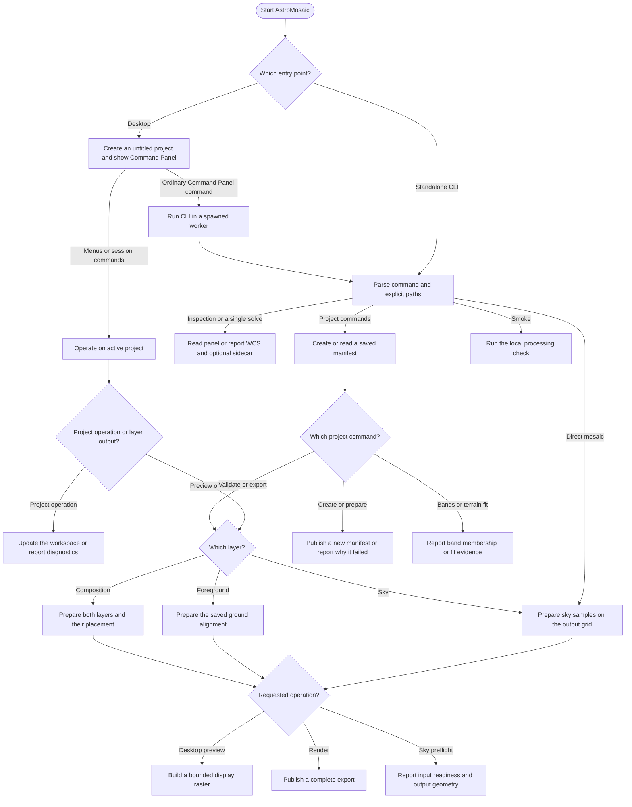
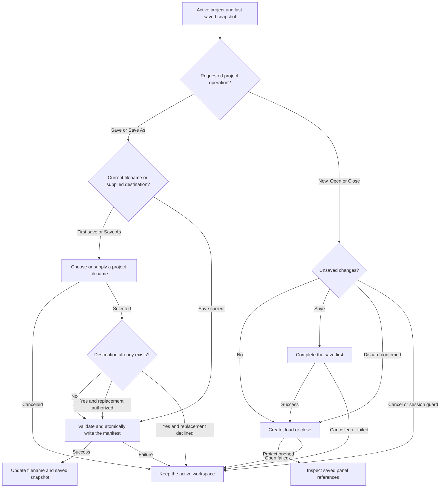
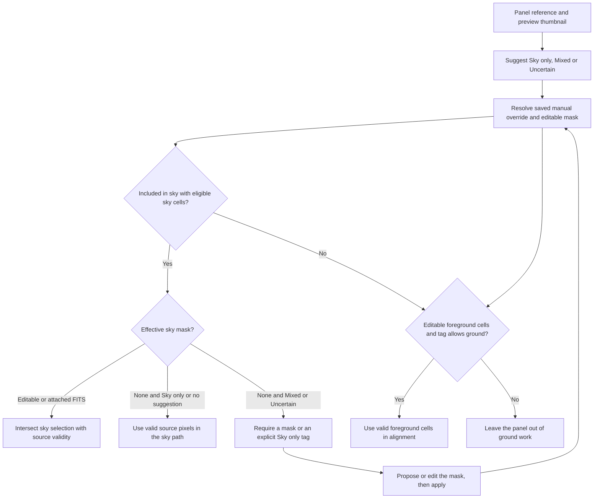
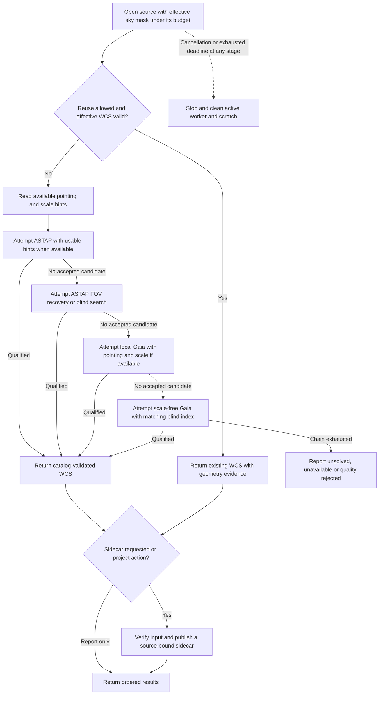
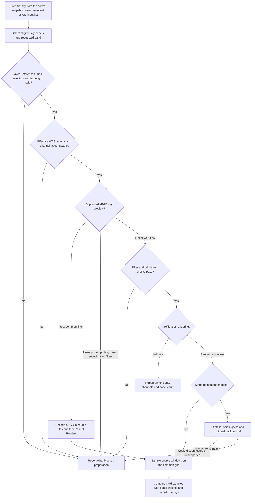
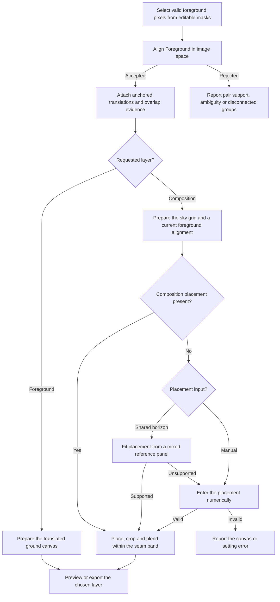
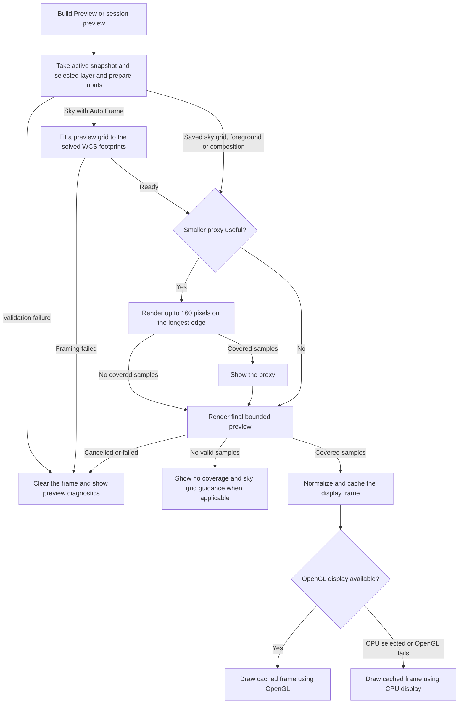
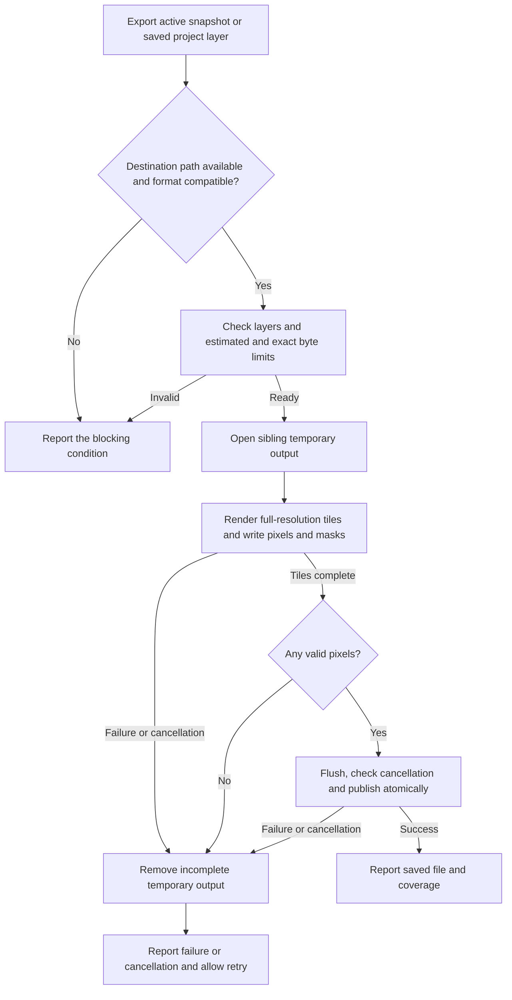
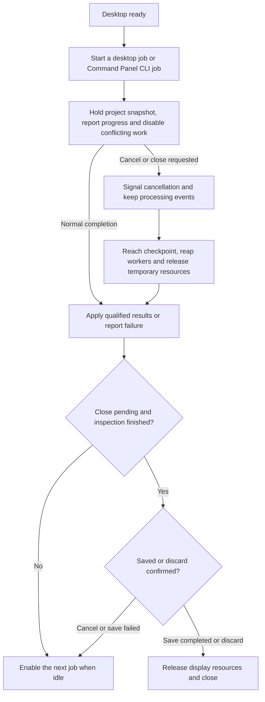

# AstroMosaic Workflow Reference

AstroMosaic 0.1.0b7 takes local astronomical panels through project setup, optional offline solving, layer preparation, preview and export. The desktop works on the active project, including unsaved edits. The standalone CLI works on explicit files. Both use the same processing engine. This reference describes the Windows 11 x64 workflow. [Windows verification](windows-release.md#verification-status)

## Contents

- [Entry points and main routes](#entry-points-and-main-routes)
- [Project and file lifecycle](#project-and-file-lifecycle)
- [Panel import and masks](#panel-import-and-masks)
- [Local plate solving](#local-plate-solving)
- [Sky grid bands and calibration](#sky-grid-bands-and-calibration)
- [Foreground and composition](#foreground-and-composition)
- [Preview and display](#preview-and-display)
- [Export and file publication](#export-and-file-publication)
- [Commands and batch workflows](#commands-and-batch-workflows)
- [Progress cancellation and recovery](#progress-cancellation-and-recovery)

## Entry Points and Main Routes

| Entry point | Initial state and available work |
| --- | --- |
| `AstroMosaic.exe` or `python -m astromosaic.ui` | Starts an untitled workspace. File menus and editing dialogs manage project state. The Command Panel starts visible. `--cpu-preview` selects CPU display. |
| `astromosaic-cli.exe`, `astromosaic` or `python -m astromosaic` | Parses the same headless commands. The invocation supplies paths and processing options and reports a result or an exit code. |
| Desktop Command Panel | `session` targets the active workspace. Ordinary commands use the same CLI parser in a spawned process. The working folder is the saved project's directory or the startup directory for an untitled project. |
| Python and PowerShell export examples | Read a job list and invoke the CLI once per saved-project export. |

The portable desktop and console launchers use the `_internal` runtime beside their own executable. Solver binaries and catalogs are supplied locally. Project settings and solver configuration have independent lifecycles. [Desktop and CLI setup](guide.md#quick-start) · [Local automation decision](adr/0016-local-automation.md)

## Project and File Lifecycle

| Scenario | Current result |
| --- | --- |
| New project | The active panel list starts empty with **Auto Frame** enabled for sky previews. The initial saved export grid is TAN with center `(0°, 0°)`, size `1024 × 1024`, scale `2 arcsec/px`, rotation zero and no crop. The common brightness declaration and relative refinement start disabled. |
| Open a project | The app decodes the manifest, restores saved settings and references, then checks panel metadata in the background. Invalid JSON, unsupported schema or invalid settings cause an open error. Missing source files can remain as saved references for relinking. |
| Save a named workspace | **Save Project** writes the active settings to the current path. First save and **Save Project As** collect a new filename. The file picker allows cancellation and an occupied destination requires explicit replacement. |
| Switch or close with dirty edits | The normal desktop actions offer Save, Discard or Cancel. A cancelled or failed save prevents the switch or close. The corresponding session commands require an explicit `--discard` or a prior successful save. |
| Relink a moved panel | Relink checks the new regular file against the saved byte size and modification time. A match updates the path. A different fingerprint rejects the change. |
| Remove a panel | The app removes the panel record from the active project. Source files and attachments are separate files. The project may need a fresh foreground alignment if the participant order or masks change. |
| Save error | An invalid filename, occupied new path, unwritable destination, oversized manifest or invalid settings leaves the desktop dirty state available for correction. The project save path must end in `.astromosaic`. |

The manifest contains panel order, weights, sky inclusion, filter and optics overrides, masks, WCS references, the saved grid and optional automatic preview setting, refinement, foreground alignment and composition settings. Relative paths are used where possible, with absolute paths across Windows drives. The reference statuses are `Ready`, `Missing`, `Changed` and `Unavailable`. A saved source fingerprint uses size and modification time. A WCS sidecar also binds to the original pixel dimensions and effective sky mask. The manifest size limit is 4 MiB. Beta 7 reads schemas 1 through 6 and writes 4 for TAN by default, 5 for ZEA, or 6 when a panel has a band override. Older manifests without the option use their saved grid. [Project persistence decision](adr/0012-project-manifest-and-render-worker.md) · [Manifest code](../src/astromosaic/storage/project.py)

## Panel Import and Masks

### Import and inspection

**Add Panels** captures references in selection order, skips paths already present and starts a foreground check for the newly added panels. Background inspection reads the header and descriptor and validates the selected WCS. A failed inspection reports the affected panel. The **Overview**, **Optics**, **Files** and **All properties** table views show the same project records with different columns. Inline edits cover sky inclusion, weight, band, focal length and the two pixel-size values. **Panel Settings** also manages the foreground override and attached WCS or FITS sky mask. Positive blend weights and valid optical edits are checked before applying the update. [Panel controls](phase-3b.md#panel-control-table) · [Optical metadata](phase-3b.md#panel-wcs-and-plate-solve-hints)

| Input | Supported reader and metadata behavior |
| --- | --- |
| FITS | Uncompressed 2D mono primary image. The reader applies `BSCALE` and `BZERO`, checks integer `BLANK`, finite samples and any supported `COVERAGE` extension. Embedded celestial WCS, `BUNIT`, `FILTER` and optical hints come from the header. |
| TIFF and BigTIFF | A top-left mono or RGB raster with signed or unsigned 16-bit integer or float32 samples. Supported segment encodings include uncompressed, LZW, Deflate and PackBits. The AstroMosaic description carries FITS metadata and may have a matching coverage SubIFD. Optical hints can come from supported TIFF metadata such as EXIF/XMP. |
| XISF | Monolithic uncompressed 2D XISF 1.0 with Float32 or UInt16 samples in mono or RGB. FITS-compatible keywords supply WCS and units. Supported inline instrument properties supply optical metadata. The named coverage image can carry a validity mask. |
| Unsupported or unreadable source | A missing, changed or unavailable reference, incompatible shape, sample type or compression, or malformed metadata produces an inspection or preparation diagnostic. |

The common tile reader uses float32 image samples and a separate validity mask. Finite zero, negative and above-one values can contribute. An RGB sample requires three finite channels, and all channels share the validity mask. Effective masks intersect the source's own validity. [FITS reference](phase-1.md) · [TIFF sample contract](phase-3a.md#sample-and-metadata-contract) · [XISF scope](phase-5a.md#scope)

### Sky and foreground decisions

- **Check Foreground** computes a suggestion on a bounded thumbnail. A manual tag overrides that suggestion. Without a manual tag, an editable content mask gives the panel mixed classification.
- **Propose Sky Mask** attempts a horizon suggestion. **More → Edit Sky Mask** opens the existing edit, a preview of the attached FITS mask, or a blank mask. The editor supports tracing a horizon, painting Sky, Foreground or Unclassified, toggling the overlay, resetting the edit, applying a nonempty mask, removing an attachment and cancelling.
- An attached FITS sky mask is a matching binary byte raster in source coordinates. It selects sky samples. The editable content mask can select both layers and uses a grid with a longest edge of up to 384 cells. For the headless workflow, `project create --label-mask` imports this grid with values `0` unclassified, `1` sky and `2` foreground.
- A malformed or changed FITS mask is reported in the editor or processing job. Applying an edited mask replaces the attachment in the active project. A changed effective sky selection can invalidate the old WCS sidecar. Ground alignment is checked against the current foreground mask cells and panel fingerprints.
- Clearing **Sky** or using `--foreground-only` excludes the panel from sky work. A ground-only panel can still align and render through a valid editable foreground mask without a celestial solution. Unclassified cells supply neither layer when a content mask is active.

[Mask workflow](phase-3d.md#desktop-workflow) · [Source-coordinate mask decision](adr/0014-source-coordinate-mask-grid.md)

## Local Plate Solving

### Setup and eligibility

**Tools → Plate Solve Settings** stores local catalog paths and limits in desktop preferences. **Check Paths** runs in the background and reports both backends. ASTAP expects its CLI executable and a folder with complete supported catalog tiles. A readable, populated Seiza Gaia DR3 catalog enables hinted Gaia when the panel has both required hints. Blind Gaia also needs the corresponding Seiza index. A missing backend, a mismatched executable, a corrupt catalog or an unavailable optional package appears in the diagnostics. Closing the settings dialog during a check requests cancellation and waits for it to finish. [Local solver settings](phase-3b.md#local-plate-solve-settings) · [Solver path checks](../src/astromosaic/astrometry/solver_setup.py)

| Invocation | Panel selection and result |
| --- | --- |
| **Plate Solve** or `session solve` | Checks sky-bearing panels and skips panels with an already usable effective WCS. A batch with no applicable panels reports reuse. A successful panel attaches its sidecar to the active project. |
| **Revalidate Plate Solution** or `session solve --panel N` | Requests a fresh catalog fit on one eligible sky panel. A failed revalidation keeps the earlier reference. |
| `solve IMAGE` | Reports one image result with an optional new `-o` sidecar. A binary `--sky-mask` can restrict star extraction. |
| `solve PROJECT --panel N` | Uses the saved mask, optics and effective WCS of one eligible sky panel. An output sidecar is optional. |
| `project solve PROJECT -o NEW` | Checks all eligible sky panels or the distinct panels listed with repeated `--panel`. It reuses valid WCS by default. `--revalidate` and `--require-edge-validation` put selected panels on the new-fit path. The new manifest publishes after all requested outcomes qualify. |

Panel inspection prefers an attached WCS sidecar. A stale, missing or malformed attached sidecar is indicated as `Invalid`. Without an attachment, a valid embedded WCS is `Embedded`, no celestial keywords gives `Missing`, and invalid geometry gives `Invalid`. A source that the reader cannot inspect is `Unavailable`. An ordinary desktop solve can recover a panel with unusable WCS. Preview and export check the active attachment and report a failure when its reference or source identity fails validation. [Desktop solving](phase-3b.md#desktop-plate-solving)

### Solver decisions and publication

1. Explicit CLI pointing takes precedence over numeric header `RA`/`DEC`. The scale comes from explicit `--scale`, positive embedded `PIXSCALE`, or focal length and effective pixel size with the saved optics overrides. ASTAP uses vertical field height. Gaia's optical hint requires equal effective X/Y scales and uses the shared value.
2. ASTAP stages a bounded masked mono FITS image in scratch. RGB solving uses the green plane. The hinted attempt can use pointing, vertical scale or both. A failed hinted fit can enter FOV recovery with retained pointing for ASTAP-only solving when both hints exist. Full blind recovery clears the stale constraints. Missing hints, setup failures and timeouts enter the ordered attempt report.
3. Manual ASTAP selection pins D05, D20, D50 or D80 and checks its local data. Automatic delegates to the verified native CLI where its choice can be identified. With unverified or incomplete choices, AstroMosaic selects the densest complete supported D-series set. The attempted and actual catalog identities are recorded.
4. Gaia hinted recovery uses measured stars, pointing and scale. An available matching index enables the blind route, which drops the pointing/scale constraints and searches `0.1–120 arcsec/px`. The workers use local data and return a candidate or a diagnostic.
5. A new solution requires at least 15 distinct accepted matches, finite usable geometry and RMS at most `max(3 arcsec, 2 × smaller center scale)`. Gaia also checks a false-match probability at most `0.001`. The application compares TAN and supported SIP models using held-out spatial evidence. Strict-edge validation requires supported held-out field-edge accuracy. Existing geometry can be reused without fresh catalog evidence.
6. The default panel deadline is 120 seconds, including preparation, search, validation and sidecar publication. The default per-attempt limit is 60 seconds, further limited by stage caps and a 10-second validation reserve. The default stage caps are 20 seconds for hinted ASTAP, 25 for ASTAP recovery, 20 for hinted Gaia and 30 for blind Gaia. ASTAP-only full blind recovery may use a 60-second cap. An optional batch deadline can expire first. Solver preparation uses a 64 MiB working budget and a 1024 MiB ASTAP staging cap by default.

The desktop saves new WCS files beside a named manifest in its `.wcs` directory or under local application data for an untitled project. The project becomes dirty when a new solution attaches. Earlier completed sidecars can attach after desktop cancellation or a later panel failure. Headless `project solve` uses an owned sidecar directory beside the destination and discards that run's new sidecars if the copy fails or is cancelled. A successful CLI copy retains the references in its new manifest. `Plate Solve Details` displays attempt outcomes, WCS model, spatial residuals and local geometry. Unsupported cells have an unavailable residual. [Solve policy and evidence](phase-36-results.md#behavior) · [Deadline verification](phase-36-results.md#deadlines-and-compatibility) · [Solver and budgets](../src/astromosaic/astrometry/solve.py)

## Sky Grid Bands and Calibration

### Grid and band selection

- **Mosaic Settings** stores the ICRS center, TAN or ZEA projection, dimensions, scale, rotation and optional in-bounds crop. Use positive dimensions, a finite center, finite rotation, a positive scale and positive budgets. Plate solving sets panel geometry. The output grid comes from the project or explicit CLI settings. A valid grid can fall partly or entirely outside the solved sky coverage.
- A sky participant's band resolves from the panel override, embedded `FILTER`, declared common filter for unlabeled inputs, then `Unspecified`. The sky layer can display the available bands after inspection. If multiple bands are detected, the toolbar asks for one band before starting a sky preview or export. `project bands` reports memberships using one-based panel numbers. `--band` chooses a band for saved-project validation or sky export. Unknown bands report the available labels.
- Without a band selection, readiness checks apply to the selected sky inputs as a group. An explicit common label supplies missing metadata and still requires agreement with the present labels. Sky and foreground composition uses the project sky selection and a common calibration across both layers. A band argument applies to sky only.
- The program validates source references, effective sky masks and WCS before sampling. A project with incompatible inputs reports their condition and can be retried after a relink or edit. `project validate` checks sky inputs and the grid, with optional destination format and preliminary size checks. Final refinement acceptance, actual coverage and exact writer limits are determined during the render.

### Calibration outcomes

| Input case | Current path |
| --- | --- |
| All panels have matching supported surface-brightness units | Preparation accepts their shared unit and records it in the sky header. |
| Compatible linear panels have missing or ambiguous units | Preparation reports the brightness requirement unless **Declare a common surface-brightness scale** or `--assume-surface-brightness` is set. The flag records a declaration for already-compatible values. |
| Present `BUNIT` values differ in scale | The job fails the unit agreement check even with a common-scale declaration. |
| A present unit contains a per-pixel basis | The job requires area-aware conversion of those inputs before mosaicking. |
| Conflicting filter labels | The job reports the filter requirement. The saved band and common-filter controls provide the grouping inputs for the next attempt. |
| Mono and RGB appear in one layer | The job requires a common channel layout. RGB sky mosaics use TIFF or XISF for output. |
| Supported sRGB TIFF with a usable WCS | The desktop sky **Visual Preview** decodes the sRGB transfer before interpolation. Science validation and export require compatible linear inputs, even if a common scale is declared. |
| Unsupported TIFF ICC profile or mixed sRGB and linear inputs | The sky preview reports the affected panel and requires a compatible input set. |

### Sampling and optional refinement

With refinement enabled, the job requires at least two mono panels. It measures isolated stars, projects them into the output frame, estimates relative shifts and stellar gains from a connected overlap graph, and checks held-out matches. `weak` and `disconnected` registrations reject the jobs that requested refinement. The background option can keep the original background, fit offsets or test a plane. It can retain a simpler model when unmasked support, rank, memory or held-out improvement is insufficient. The working corrections apply when reading source samples. [Refinement evidence](phase-2.md#relative-refinement) · [Refinement implementation](../src/astromosaic/pipeline/refinement.py)

The CPU renderer uses float64 coordinate math and bounded source windows. It maps output pixel centers through WCS, applies the accepted shifts and valid bilinear support, and combines contributions using positive panel weights. A conservative footprint can exclude a panel from a tile. Uncertain footprints use the normal full candidate path. Invalid mappings, including invalid sky around a projection boundary, contribute no valid sample. A large tile is split when necessary, and a budget that cannot hold one output pixel and its source window fails with a diagnostic. [Sky projections](phase-5b.md) · [Band workflow](phase-5c.md) · [Surface-brightness decision](adr/0002-surface-brightness-reference.md) · [Tiled renderer](../src/astromosaic/pipeline/mosaic.py)

## Foreground and Composition

| Scenario | Current path |
| --- | --- |
| One masked ground panel | The accepted ground layer uses the panel as its anchor in image space. A WCS is unnecessary for this route. |
| Multiple comparable ground panels | The translation matcher uses bounded thumbnails and full-resolution verification where needed. It fits accepted links into a common anchored canvas. The renderer uses matching source dimensions and a shared ground scale and orientation. |
| Weak, ambiguous or disconnected ground overlaps | Alignment reports the available pair evidence and rejection. **Foreground Alignment Details** can show support, correlation, competing peaks, graph residuals and access to the selected masks. A rejected update leaves the previous project state available. |
| Alignment becomes stale | Ground rendering requires the saved participant order, fingerprints and foreground mask selection to agree with the current inputs. A successful alignment with changed geometry clears the composition placement. |
| Shared horizon available | **Propose Placement** evaluates horizon points in both the sky grid and foreground canvas. It chooses a supported mixed reference panel by fit error and stores its similarity placement and residual. |
| Shared horizon missing or weak | The proposal reports the support failure. **Composition Settings** or `project set-placement` takes a numeric offset, rotation, scale, seam row, overlap and sky bottom crop. The placement must retain at least one sky row and fit the supported canvas. |
| Composition rendering | The program prepares both layers, checks compatible channels, filters and brightness, and fits their union canvas. One-layer samples retain their value. Where both layers cover a sample, a horizontal seam selects or blends them. A zero-width seam is a hard switch. A positive width uses the saved overlap percentage of the shorter effective layer height. |

Foreground stitching stores translations. The composition similarity transform places the **whole** aligned ground canvas against the sky grid. Its coordinates are zero-based with positive Y downward. The overlap display marks samples where the sky and ground both have validity. A sky projection change clears the saved composition placement. [Mixed-layer workflow](phase-3e.md#desktop-workflow) · [Layer renderer](../src/astromosaic/pipeline/layers.py)

### Terrain control-point diagnostics

`project fit-foreground` reads the saved editable ground masks and runs with either supplied `--points` or `--automatic` with the optional SIFT provider. Manual points use version 1 JSON, one-based panel numbers and zero-based `[x, y]` coordinates. Automatic matching can use separate `--holdout` points. The command evaluates translation, similarity or automatic model selection and can keep a requested `--anchor` fixed. The report includes poses, groups, per-link and per-point outcomes, and automatic matching evidence when applicable. Weak or disconnected fits produce a failure report. Supply `--output` to save an accepted fit to a new project for foreground or composition rendering. [Manual terrain fit](phase-7.md#run-a-manual-terrain-fit) · [Automatic terrain fit](phase-7.md#run-the-automatic-terrain-fit) · [Save and render](phase-7.md#save-and-render-a-terrain-fit)

## Preview and Display

The final preview is at most 512 samples along its longest edge. A valid coarse proxy can appear first. **Auto Frame** fits the selected sky footprints to a temporary ICRS grid and shows **Use Preview Grid** after a covered result. This action applies the framing to the export settings. With **Auto Frame** off, the saved sky grid supplies the preview geometry. A completed preview with no coverage reports that outcome explicitly. A cancelled or failed render clears the preview, including any proxy that appeared earlier. [Preview geometry](phase-3c.md#geometry-and-display)

Display normalization uses the 1st and 99.5th percentiles of valid samples with linked RGB levels. **Midtones**, pan, pointer-centered zoom and **Fit View** act on the cached display. **Highlight Overlap** is available for a composition with a common-coverage map. Changing the active project, layer or band can clear the cached preview and require a new build. **View → Theme** stores the application's Dark or Light appearance preference. Pixel processing remains on the CPU, with OpenGL used for display when available. Context, shader or upload failure switches to CPU display and preserves the usable frame. [Preview implementation](../src/astromosaic/ui/sky_viewport.py) · [Display normalization](../src/astromosaic/display.py)

**sRGB TIFF scenario.** Add unsigned 16-bit RGB TIFFs tagged with a supported sRGB ICC profile, solve their WCS and choose **Build Preview**. The **Visual Preview** decodes the sRGB transfer before combining the panels. Its inputs stay unchanged. Unknown profiles or a mixture with linear or untagged panels give a panel-specific error. Scientific exports require compatible linear inputs. [Desktop preview workflow](phase-3c.md#desktop-workflow) · [Recorded sRGB preview case](../questions_open_topics.md#q-028---automatic-sky-preview-for-solved-panels)

## Export and File Publication

The desktop **Export Mosaic** file picker appends the selected format suffix when the filename has no suffix. Session and CLI commands receive the destination explicitly. The writer routes `.tif` and `.tiff` to TIFF and `.xisf` to XISF. Other suffixes take the FITS path. Use a normal FITS extension for a mono FITS deliverable. A missing directory, occupied target or incompatible format can stop the job before rendering. Output files use new paths. Explicit replacement applies to project saving, where the app writes a complete manifest atomically.

| Output | Science raster and companion rasters |
| --- | --- |
| FITS | Mono float32 primary HDU and byte `COVERAGE` extension. Composition adds a `LAYERS` extension. |
| TIFF | Mono or RGB float32 science image with WCS or history in the AstroMosaic description and a coverage SubIFD. Composition uses its second SubIFD for `LAYERS` and the version 2 description. |
| XISF | Uncompressed mono or RGB float32 with `AstroMosaicCoverage`. Composition also includes `AstroMosaicLayers`. |

Sky exports carry the applicable TAN or ZEA WCS along with units, band and processing history. Ground exports use image-space geometry. Composition records the sky grid and placement as provenance and adds byte contribution values `0` uncovered, `1` sky, `2` foreground and `3` both. Coverage uses binary valid pixels, with NaN science samples in holes. Display stretch is applied to the preview buffer and the export writer receives the linear render values. [Format contracts](phase-3a.md#sample-and-metadata-contract) · [XISF outputs](phase-5a.md#scope) · [Composition format](phase-3e.md#geometry-and-formats)

The default render limits are a maximum tile side of 128, a working budget of 64 MiB and an output budget of 2048 MiB. Source decode buffers, working arrays and mask rasters count toward the budget. Exact writer checks include the format's metadata and companion rasters. With no valid covered samples the writer rejects publication. The writer flushes and checks the cancellation state before publishing. A guarded publication also checks immediately after the rename and removes its own output if that check fails. Existing output is protected from accidental replacement. A failure or accepted cancellation cleans temporary files and permits retry at the available destination. [Atomic publication](../src/astromosaic/io/atomic.py) · [Large mosaic measurements](phase-4b.md)

## Commands and Batch Workflows

### Standalone CLI and Command Panel CLI commands

| Command | Input, action and result |
| --- | --- |
| `--help`, `--version` | Show the available commands or the installed application version. Subcommands have their own help. |
| `inspect` | Read a panel's descriptor, scaling, optical metadata, embedded scale and available WCS provenance and print JSON. |
| `smoke` | Run the local synthetic FITS/WCS smoke check and report the result. `--spawn` exercises a spawned worker. |
| `solve` | Report one image or saved-project panel's WCS attempts. With `-o`, write a new sidecar after success. |
| `mosaic` | Render sky directly from panel paths, explicit grid options and usable embedded WCS or supplied `--wcs PANEL=PATH`. Input weights, binary masks, calibration and mono refinement are options. |
| `project create` | Capture ordered panel paths, validate supplied masks or WCS and save a new `.astromosaic` file. A panel without solved WCS can be saved for later solving. Grid options, weights, band overrides, brightness declaration, label masks and ground-only selection are accepted. |
| `project relink` | Apply one or more fingerprint-matching `--panel PANEL=PATH` changes and save to a new manifest. |
| `project solve` | Reuse or qualify the requested sky WCS and attach successful solutions to a new manifest. |
| `project bands` | Report current sky band labels and one-based member panel numbers from a saved project. |
| `project validate` | Check the saved sky setup, optionally with `--band` and a proposed output path. Report the cropped output dimensions and channels. |
| `project align-foreground` | Fit image-space translation from saved editable ground masks and save a new project. |
| `project propose-placement` | Use a shared horizon to compute placement and save a new project. |
| `project set-placement` | Apply numeric placement, seam and crop settings to a project copy with a current ground alignment. |
| `project fit-foreground` | Fit supplied or automatic terrain control points and optionally save the alignment. |
| `project export` | Render a saved `sky`, `foreground` or `composition` layer to a new image. `--band` selects a sky band and `--progress` reports completed tile progress. |

The command panel accepts quoted paths, keeps Windows backslashes and strips an optional AstroMosaic launcher name. Enter or **Run** submits the command. Up and Down recall recent commands, with up to 100 commands and the latest 2,000 output blocks kept in the session. Hidden panels continue to collect desktop summaries. Ordinary CLI commands operate on saved files and send output and progress back from their separate process. [Console and desktop parity](phase-4c.md#desktop-workflow) · [Worker decision](adr/0019-desktop-command-worker.md) · [CLI parser](../src/astromosaic/cli/__init__.py) · [Project command parser](../src/astromosaic/cli/project.py)

### Live desktop session commands

| Command | Input and result |
| --- | --- |
| `session --help` | Show the live session commands and individual command help. |
| `session status` | Print JSON with schema version, project path, panel count and dirty state. |
| `session new` | Create an untitled workspace. `--discard` authorizes dropping unsaved changes. |
| `session open PATH` | Open the specified manifest. The dirty guard uses the same `--discard` switch. An invalid or missing manifest leaves the active project available. |
| `session close` | Request a graceful window close. A dirty workspace requires save or `--discard`. |
| `session save [PATH]` | Save the active workspace, including unsaved edits. First save needs a destination. A named existing destination requires `--replace`. Omitting the path saves to the active project's filename. |
| `session add PATH ...` | Add explicit panel paths to the active project and start the foreground check. |
| `session relink N PATH` | Relink one live panel by index and matching fingerprint. |
| `session preview [--grid auto\|saved]` | Build the active layer and selected band's desktop preview. The optional sky grid mode is saved with the project. |
| `session use-preview-grid` | Copy the current fitted sky preview grid to the project's export settings. |
| `session solve [--panel N]` | Start the desktop solve batch or revalidate one sky panel with the local desktop settings. |
| `session export -o PATH` | Render the live snapshot to a new file. Optional `--layer` and `--band` select the requested output. |

These commands collect paths and explicit choices as arguments. Errors such as an occupied destination or unsafe discard appear in Command Panel output. Long session operations use the existing desktop job, its status and **Cancel Job**. The ordinary CLI commands keep their separate **Cancel Command** control. [Live session workflow](phase-4c.md#control-the-active-project-without-dialogs) · [Session command parser](../src/astromosaic/ui/command_panel.py)

### Structured results and batches

| Result | Meaning |
| --- | --- |
| Exit `0` | The requested inspection, preparation, fit or render completed successfully. For an export this includes publication. |
| Exit `1` | A processing, validation or output error occurred, or the selected solve or fit was rejected. |
| Exit `2` | Command arguments were rejected and usage is printed. In the batch examples this code also covers an unreadable or invalid batch list. |
| Exit `130` | Cancellation or interruption reached the job's cancellation path. |

With `--json`, project commands emit a versioned result on stdout. Progress and diagnostics use separate newline-delimited JSON on stderr. `project export --progress` reports processed pixels. `project solve --progress` reports completed panels. Terrain fit can report completed work and its final diagnostics. The result and exit code distinguish prepared output from failed or cancelled work. For CLI syntax errors the argument parser prints usage. [Result contract](phase-4a.md#result-contract)

The Python and PowerShell batch examples load a JSON list with `project` and `output`, optional `layer` and optional `band`. Relative entries use the list's directory. Each job runs `project export --json --progress`. Ordinary job errors such as missing inputs or occupied outputs are reported and the later jobs can continue. Successfully published results remain available. On interruption, the active job receives cancellation, cleans incomplete output and stops the batch. A retry can use the original free output path. [Batch workflow](phase-4a.md#run-a-batch) · [Python example](../examples/export_batch.py) · [PowerShell example](../examples/export-batch.ps1)

## Progress Cancellation and Recovery

Desktop output, preparation and solve work run off the UI thread. A regular desktop background job and an isolated Command Panel CLI job share the workspace's foreground-job controls. Metadata inspection has its own background work and follows the current project. The desktop disables conflicting project edits and new work while a job is active. Plate Solve uses an animated activity bar with the active panel number. Render reports processed samples or pixels. Workers check cooperative cancellation during eligible stages and file publication. Standalone project jobs can be interrupted from the console. [Desktop job implementation](../src/astromosaic/ui/mosaic_job.py) · [Command worker](../src/astromosaic/cli/worker.py) · [Native Windows lifecycle](phase-6.md#6e-verify-native-lifecycle-and-windows-packages)

| Where the operation stops | State available for retry |
| --- | --- |
| Add Panels rejects an invalid path | The original project remains available. The foreground check can report individual panel errors after references were added. |
| Metadata inspection or source check fails | The row and its saved reference remain available. Relink can recover a moved source with the same fingerprint. A genuinely modified file requires the project to use a new reference. |
| Solver settings check is dismissed | The dialog requests cancellation and waits for the check to finish before dismissing. |
| A solver attempt is skipped, fails or times out | The chain can try the next eligible backend within the remaining budget. The result records the stage and reason. |
| Solver scratch or sidecar storage is unavailable | The attempt or job reports the resource or path error. A named project's sidecar directory comes from its saved location. An untitled desktop project needs a usable local application data location. |
| Desktop solve is cancelled or its batch deadline elapses | Completed panel outcomes can be attached. Retrying the ordinary batch checks panels that still lack usable WCS. |
| Headless project solve fails or is cancelled | The destination copy and this run's sidecars are cleaned up. The input manifest is available for a retry. |
| Mask preparation is cancelled or an edit is dismissed | The saved selection is available for another edit. Closing during preparation skips opening the editor. |
| Alignment or placement is rejected | The previous project settings remain available. The diagnostic indicates mask, overlap, geometry or resource conditions that blocked the update. |
| Preview fails, is cancelled or finds no coverage | A failed or cancelled job clears the frame. A completed zero-coverage frame reports no coverage. Correct preparation or grid settings can be used on the next build. |
| Export or manifest publication fails | Temporary data is removed. Once the destination is free and the reported cause corrected, retry uses the same path. |
| The window is closed during a job or inspection | The window waits for cleanup, then resumes the normal unsaved-project decision. The cancel choice returns to the workspace. |

The individual phase documents contain numerical gates, fixture provenance, verification and open platform acceptance. [Windows packages and verification](windows-release.md#verification-status) · [Architecture and phase plan](../astro_mosaic_python_first_architecture_en.md#10-revised-milestones)
